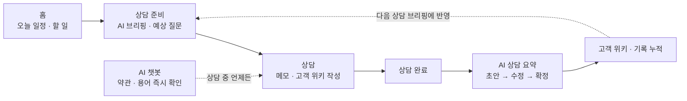
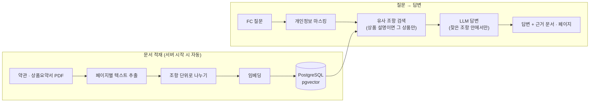
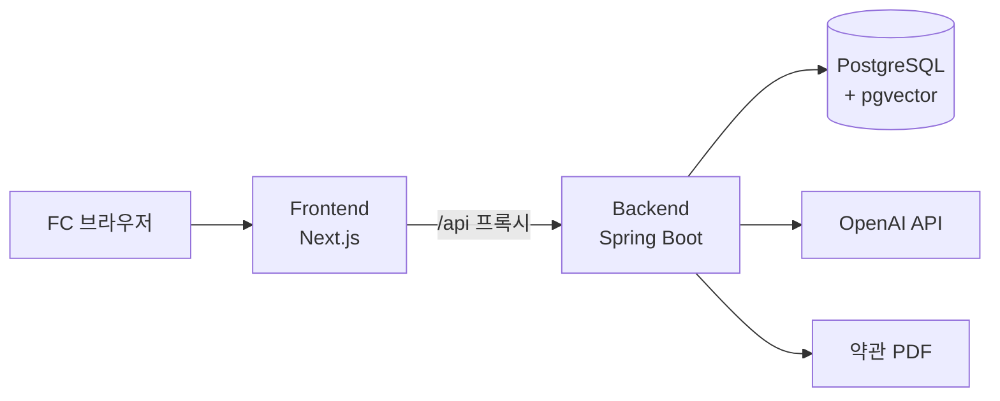
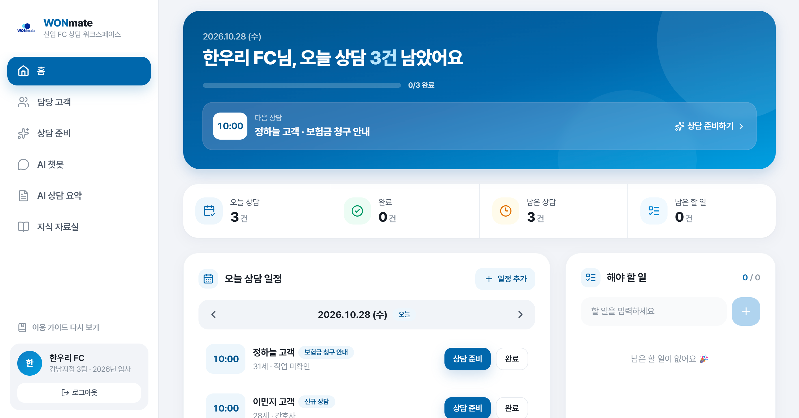
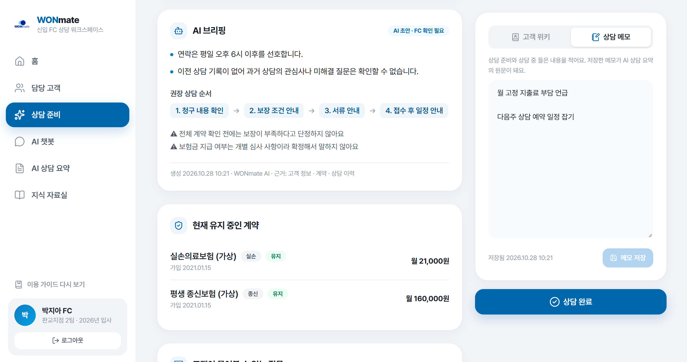

<div align="center">

<h1>
  
  WONmate
</h1>

### 신입 FC의 첫 상담부터 기록까지, AI가 옆에서 함께하는 상담 워크스페이스

`2026 금융AX 해커톤` · `우리WON 청년 IT 아카데미`
주제 — **일상 속 금융 불편함을 AI로 해결하라**

<br/>

| 지난 기록은 **AI가 브리핑으로** | **근거 있는 답**만 알려줘요 | 초안은 AI가, **확정은 FC가** |
| :---: | :---: | :---: |
| 고객 위키 · 이전 상담을 모아<br/>상담 직전 한 장으로 요약 | 실제 약관 · 상품요약서에서 찾고<br/>**원본 PDF 페이지**까지 연결 | 상담 메모를 5개 항목으로 정리<br/>FC가 고치고 확정해야 기록 완성 |

</div>

---

## 이런 고민에서 시작했어요

> "내일 상담인데 이 고객 지난번에 뭐라고 했더라…"
> "고객이 면책기간 물어보는데 약관 몇 페이지에 있지?"
> "상담 끝났는데 기록 정리하다 퇴근이 늦어지네…"

신입 FC는 상담 하나를 위해 **고객 정보 · 계약 · 지난 상담 · 약관**을 여기저기서 찾고, 상담이 끝나면 기록 정리에 또 시간을 씁니다.
경험이 부족할수록 이 부담은 더 크고, 잘못된 안내는 곧 **불완전판매** 위험으로 이어집니다.

**WONmate는 흩어진 상담 업무를 한 곳에 모으고, AI가 준비 · 답변 · 기록을 돕습니다.**
단, AI는 초안과 근거를 제시할 뿐 **최종 판단은 항상 FC가** 합니다.

---

## 핵심 AI 기능

### 📋 AI 브리핑 — 상담 준비를 5분으로

| | |
| --- | --- |
| **언제** | 상담 직전, 상담 준비 화면에서 일정을 고르면 |
| **AI가 하는 일** | **고객 위키 + 완료된 이전 상담 기록**을 읽고<br/>• 이 고객에 대한 **핵심 요약**<br/>• 고객이 **물어볼 만한 질문** (FC가 답변을 미리 메모) |
| **함께 보여주는 것** | 현재 유지 중인 계약 · 상담 종류별 **상담 순서** · 주의 문구 · **상담 전 필수 확인사항** (본인 확인, 개인정보 동의, 고지의무 안내 등) |
| **이어지는 흐름** | 같은 화면에서 **고객 위키 · 상담 메모**를 작성하고 → **상담 완료** |

> 만든 브리핑은 서버에 저장돼서 새로고침하거나 다른 기기에서 열어도 그대로 이어볼 수 있어요.

### 💬 AI 챗봇 (RAG) — 약관에 근거한 답변

| | |
| --- | --- |
| **질문 유형** | **용어 설명** "면책기간이 뭐예요?"<br/>**개념 설명** "갱신형과 비갱신형 차이가 뭐예요?"<br/>**상품 설명** 대분류 → 상품 선택 후 "암 진단비는 언제부터 보장돼요?" |
| **AI가 하는 일** | 실제 **보험 약관 · 상품요약서**에서 관련 조항을 찾아, 그 안에서만 답변 |
| **근거 표시** | 답변마다 **문서명 · 조항 · 페이지**를 보여주고, 누르면 **원본 PDF의 해당 페이지**가 바로 열림 |
| **안전장치** | 근거가 없으면 지어내지 않고 보류 · 질문 속 **이름 · 연락처 · 주민번호 · 이메일 자동 마스킹** · 질문/답변은 저장하지 않음 |
| **학습 자료** | 종신 · 암 · 어린이보험 **10개 상품, 약관과 상품요약서 20개 문서** (조항 단위로 1만 6천여 개 조각) |

### ✍️ AI 상담 요약 — 기록은 AI가, 확정은 FC가

| | |
| --- | --- |
| **언제** | 상담 완료 후, AI 상담 요약 화면에서 |
| **AI가 하는 일** | 상담 메모 원문을 5개 항목으로 정리<br/>**고객 요구 · 설명한 내용 · 고객 질문 · 미해결 사항 · 다음 행동** |
| **FC가 하는 일** | 메모 원문과 비교하며 수정 → **확정** (확정 후에는 수정 불가) |
| **왜 중요한가** | AI 초안을 그대로 쓰지 않고 **사람이 검토 · 확정**해야 공식 기록이 됨 → 기록의 신뢰성 확보 |

---

## 업무를 돕는 기능들

| 화면 | 할 수 있는 것 |
| --- | --- |
| **홈** | 오늘 상담 · 완료 · 남은 상담 · 남은 할 일 한눈에 보기, 오늘 일정 타임라인, **상담 예약 추가**, **해야 할 일** 체크리스트 |
| **담당 고객** | 고객 검색, 기본 정보 · **보유 계약**(상태 · 월 보험료) · **고객 위키** · **이전 상담 기록** 모아보기 |
| **고객 위키** | 상담하며 알게 된 고객 특징을 계속 쌓는 메모장 → **다음 AI 브리핑의 재료**가 됨 |
| **AI 상담 요약 목록** | 작성 중인 기록 / 확정된 이전 상담을 탭으로 구분 |
| **지식 자료실** | AI 챗봇이 참고하는 약관 · 상품요약서를 대분류별로 찾아보고 원본 PDF 열기 |
| **온보딩 가이드** | 처음 로그인한 FC에게 핵심 기능 안내 |

---

## 신입 FC의 하루, WONmate와 함께



**상담이 쌓일수록 브리핑이 똑똑해지는 구조**: 오늘의 메모와 확정 기록이 다음 상담의 AI 브리핑 재료가 됩니다.

---

## 믿고 쓸 수 있는 AI를 위한 설계

| 원칙 | 적용 |
| --- | --- |
| **사람이 최종 결정** | AI 브리핑 · 상담 요약은 모두 "AI 초안" 표시, 상담 요약은 FC 확정 후에만 기록으로 남음 |
| **근거 기반** | 챗봇은 적재된 약관 안에서만 답하고, 근거 문서와 페이지를 반드시 함께 제시 |
| **단정 금지** | 보험금 지급 여부처럼 심사가 필요한 내용은 확정해서 말하지 않도록 안내 |
| **개인정보 보호** | 챗봇 질문의 개인정보를 AI 전송 전에 가리고, 질문 · 답변은 저장하지 않음 |
| **권한 분리** | 모든 API는 로그인(JWT) 필요, FC는 **본인 담당 고객**의 정보만 조회 가능 |

---

## AI 챗봇은 이렇게 동작해요



---

## 기술 스택

| 영역 | 기술 |
| --- | --- |
| **Frontend** | Next.js 16 · React 19 · TypeScript · Tailwind CSS v4 · SWR · Zustand |
| **Backend** | Spring Boot 4 · Java 21 · Spring Security (JWT) · Spring Data JPA · Swagger |
| **AI** | Spring AI · OpenAI (브리핑 · 상담 요약 · 챗봇, 임베딩 `text-embedding-3-small`) · Apache PDFBox |
| **Database** | PostgreSQL 17 + pgvector |
| **Infra** | Docker Compose · Docker Hub |



<details>
<summary><b>폴더 구조</b></summary>

```
.
├── frontend/            # Next.js 웹 (WONmate-Frontend)
├── backend/             # Spring Boot API (WONmate-Backend)
├── documents/           # 약관 · 상품요약서 PDF + metadata.json (git 제외)
│   └── product_01/
│       ├── metadata.json
│       ├── ..._약관.pdf
│       └── ..._상품요약서.pdf
├── docker-compose.yml
└── .env                 # 비밀 값 (git 제외)
```
</details>

<details>
<summary><b>주요 API</b></summary>

| 기능 | Method | Endpoint |
| --- | --- | --- |
| 로그인 · 내 정보 | `POST` `GET` | `/api/auth/login`, `/api/users/me` |
| 담당 고객 | `GET` | `/api/customers`, `/api/customers/{id}` |
| 계약 | `GET` | `/api/contracts/{customerId}` |
| 고객 위키 | `GET` `POST` | `/api/customers/{id}/wiki`, `/wiki/entries` |
| 상담 일정 | `GET` `POST` | `/api/consults`, `/api/consults/{id}`, `/api/consults/records` |
| AI 브리핑 | `POST` `GET` | `/api/consults/{id}/briefing` |
| 상담 메모 · 완료 | `GET` `PATCH` `POST` | `/api/consults/{id}/memo`, `/complete` |
| AI 상담 요약 | `POST` `GET` `PATCH` | `/api/consults/{id}/ai-record`, `/ai-record/confirm` |
| 할 일 | `GET` `POST` `PATCH` | `/api/todos`, `/api/todos/{id}/status` |
| AI 챗봇 | `POST` | `/api/rag/ask` |
| 상품 · 문서 | `GET` | `/api/products`, `/api/documents`, `/api/documents/{id}/file` |

전체 명세는 Swagger(`/swagger-ui/index.html`)에서 확인할 수 있어요.
</details>

---

## 📸 화면

### 홈



### AI 챗봇



---

## 🚀 프로토타입 실행 방법

### 바로 써보기

| | |
| --- | --- |
| **시연 주소** | `http://<서버 주소>` |
| **시연 계정** | `fc01` ~ `fc05` / `Wonmate2026!` |

> 모든 고객 · 계약 데이터는 가상입니다. 계정마다 담당 고객 5명과 보유 계약이 들어 있어요.

### 내 PC에서 실행하기

**준비물**: [Docker Desktop](https://www.docker.com/products/docker-desktop/) · OpenAI API Key · 약관 PDF(`documents/`)

**1. 소스 받기**

```bash
mkdir wonmate && cd wonmate
git clone https://github.com/woori-won-hackerton/WONmate-Frontend.git frontend
git clone -b develop https://github.com/woori-won-hackerton/WONmate-Backend.git backend
cp -r backend/deploy/. .        # docker-compose.yml, db-init/, .env.example
```

**2. 환경 변수 (`.env`)**

```bash
cp .env.example .env
```

```env
DB_NAME=wonmate
DB_USERNAME=wonmate
DB_PASSWORD=원하는_비밀번호
JWT_SECRET=32자_이상_랜덤_문자열
OPENAI_API_KEY=sk-...
RAG_INGEST_ON_STARTUP=true
JWT_ACCESS_TOKEN_EXPIRATION_SECONDS=43200
```

**3. 약관 PDF 넣기**

```
documents/
└── product_01/
    ├── metadata.json      # 상품명 · 파일명 · 문서 종류(TERMS/SUMMARY)
    ├── ..._약관.pdf
    └── ..._상품요약서.pdf
```

**4. 실행**

```bash
docker compose up -d --build
docker compose logs -f backend    # "RAG ingest: finished" 가 찍히면 챗봇 준비 완료
```

**5. 접속**

| 서비스 | 주소 |
| --- | --- |
| 웹 | http://localhost |
| API 문서 (Swagger) | http://localhost:8080/swagger-ui/index.html |

로그인: `fc01` ~ `fc05` / `Wonmate2026!`

> DB는 처음 만들 때만 초기화 SQL(시연 데이터)이 실행돼요. 처음부터 다시 시작하려면 `docker compose down -v` 후 다시 실행하세요.
> 약관 PDF는 처음 한 번만 적재돼요 (문서 20개 기준 약 10분). 이미 적재한 파일은 다시 켜도 건너뜁니다.

### 서버 배포

```bash
# 내 PC (루트)
docker compose build
docker compose push

# 서버 (docker-compose.yml · .env · documents/ 필요)
docker compose pull
docker compose up -d --no-build
```

---

<div align="center">

**WONmate** — 신입 FC 곁의 든든한 상담 파트너

</div>